# Fatih Akyol 

**Senior Frontend Developer** · React · Next.js · TypeScript · Node.js

I build production web and desktop apps and ship them end to end: web apps run live on my own
server, desktop apps install on Windows and macOS. **Everything below is open source.**

[**fatihakyol.com**](https://fatihakyol.com) &nbsp;·&nbsp; [**LinkedIn**](https://www.linkedin.com/in/mfatihakyol/) &nbsp;·&nbsp; [**Email**](mailto:muhammedfatihakyol@gmail.com) &nbsp;·&nbsp; [**CV**](https://fatihakyol.com/Fatih_Akyol_CV.pdf)

---

## 💼 At Work

**Senior Frontend Developer @ Naxxt Software** · 2021 – now · Istanbul

- **Frontend lead** in a 7-person team: architecture, library choices, code standards, reviews and mentoring 5 junior developers
- **Shipped ~15 client projects across industries:** admin dashboards, e-commerce storefronts with checkout and payments, internal desktop apps and React Native mobile apps
- **Kiosk software** in Electron, integrated with bill and coin acceptors, running on 50+ devices
- **Moved a business-critical admin dashboard from ASP.NET 4.5 to Next.js:** ~4x faster pages, a far more usable UI and stricter role-based access
- **Closed security gaps** with a Backend-for-Frontend layer: httpOnly cookie sessions, permissions enforced on the server
- **Modernized legacy apps:** AngularJS, jQuery and Angular 4–9 codebases moved to React and Next.js

---

## 🖥️ Desktop Apps

| App | What it does | Platforms | Get it |
|---|---|---|---|
| 📋 **Clipboard History** | Clipboard manager that opens right under the field you're typing in, without taking focus. Native helpers in C# (Win32, UI Automation) and Swift (Accessibility API) | Windows · macOS | [download](https://github.com/mfakyol/clipboard-history/releases/latest) · [repo](https://github.com/mfakyol/clipboard-history) |
| 📺 **Screen Splitter** | Digital signage for store TVs and kiosks — split a screen into zones, give each a web page, play them full screen on every monitor | Windows · macOS | [download](https://github.com/mfakyol/screen-splitter/releases/latest) · [repo](https://github.com/mfakyol/screen-splitter) |

Both built with **Electron + React**, shipped as installers on GitHub Releases.

---

## 🚀 Live Web Apps

| Project | What it does | Live Demo | Code |
|---|---|---|---|
| 💬 **Realtime Chat** | Full messaging platform — 1:1 & group chats, read receipts, typing indicators, file sharing, presence | [chat.fatihakyol.com](https://chat.fatihakyol.com) | [repo](https://github.com/mfakyol/chatapp) |
| 📹 **Meet** | Zoom-like video conferencing with mesh WebRTC — media never touches the server | [meet.fatihakyol.com](https://meet.fatihakyol.com) | [repo](https://github.com/mfakyol/meet) |
| 🖊️ **Collab Whiteboard** | Real-time multi-user drawing on an infinite canvas | [draw.fatihakyol.com](https://draw.fatihakyol.com) | [repo](https://github.com/mfakyol/whiteboard) |
| 🧑‍💻 **Code Editor** | CodePen-style in-browser playground with live preview & server-side preprocessor compilation (Sass, Less, Pug…) | [codeeditor.fatihakyol.com](https://codeeditor.fatihakyol.com) | [repo](https://github.com/mfakyol/code-editor) |
| 🔗 **Lynx** | URL shortener with click analytics — charts, world map, GeoIP & device tracking | [lynx.fatihakyol.com](https://lynx.fatihakyol.com) | [repo](https://github.com/mfakyol/lynx) |
| 🌐 **Links** | Linktree-style link-in-bio page builder with drag & drop ordering | [links.fatihakyol.com](https://links.fatihakyol.com) | [repo](https://github.com/mfakyol/links) |
| 🧰 **Toolbox** | Developer utilities — image/font/favicon conversion, one-time secret sharing, file transfer | [toolbox.fatihakyol.com](https://toolbox.fatihakyol.com) | [repo](https://github.com/mfakyol/toolbox) |
| ⌨️ **Typing Test** | Typing speed (WPM) & accuracy test | [typing.fatihakyol.com](https://typing.fatihakyol.com) | [repo](https://github.com/mfakyol/typing) |
| 🎨 **Portfolio** | My site — Next.js server components, mobile first, bilingual (EN/TR), CSS-only animations | [fatihakyol.com](https://fatihakyol.com) | [repo](https://github.com/mfakyol/portfolio) |

All deployed by me on a Linux server with **Docker Compose + nginx**.

---

## 🛠️ Tech Stack

*plus: React Native · Socket.io · WebRTC · Zustand · TanStack Query · Playwright · Three.js*

---

🌱 Currently exploring: **GraphQL**

💼 **Senior Frontend Developer @ Naxxt Software** · 📍 Istanbul, Turkey · Open to new opportunities
